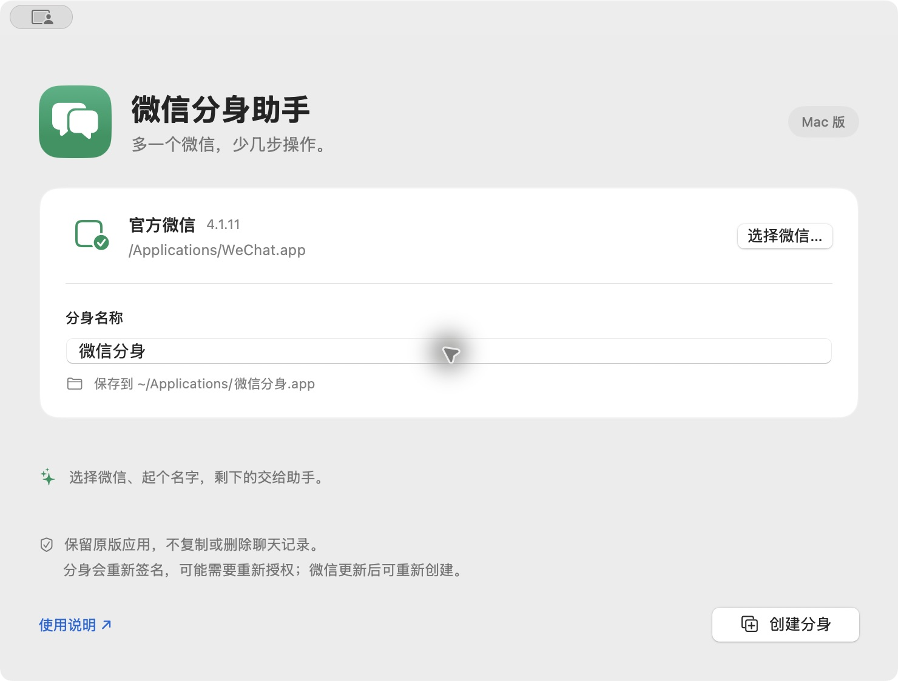

# 微信分身助手 · WeChat Dual for Mac

不用终端，也能在 Mac 上创建微信分身。选择已安装的微信、填写分身名称，点击「创建分身」，完成后打开并扫码登录另一个账号。

[下载最新版](https://github.com/bailuochen/wechat-dual-mac/releases/latest) · [反馈问题](https://github.com/bailuochen/wechat-dual-mac/issues)



## 下载和使用

1. 在 [Releases](https://github.com/bailuochen/wechat-dual-mac/releases/latest) 下载 `WeChatDual-版本号-macOS.zip` 并解压。
2. 将「微信分身助手.app」拖到「应用程序」，双击打开。
3. 助手会尝试识别 `/Applications/WeChat.app`；也可点击「选择微信…」选择官方应用。
4. 填写一个没有使用过的分身名称，例如「工作微信」，点击「创建分身」。等待完成，再点击「打开分身」。
5. 用另一个微信账号扫码登录。以后可直接从个人「应用程序」目录打开分身，也可以把它保留在程序坞。

**首次打开提示：** 当前发布包使用本地临时签名，没有 Apple Developer ID 签名和公证。macOS 可能阻止启动；请在尝试打开后，前往「系统设置 → 隐私与安全性」，确认来源后使用系统提供的「仍要打开」。如果系统没有提供允许选项，或设备受单位策略管理，请遵循设备策略。本项目不自动移除隔离属性，不要求关闭 Gatekeeper 或防火墙。

## 系统与兼容性

- 助手支持 macOS 13 及以上；发布包为 Universal，包含 Apple Silicon 和 Intel 两种架构。
- 实际双开验证环境：**macOS 15.0 + 官方微信 4.1.11**。支持两种 CPU 架构构建，不代表已在两种实体设备上验证。
- 已通过图形界面实测「创建分身 → 打开分身 → 显示扫码登录」，同时保留原有微信进程。[创建成功截图](docs/success.png)
- 微信的不同版本、发行渠道和后续更新，可能使这种方法失效。项目不承诺所有版本都能多开。
- 请从微信官方网站或 Mac App Store 安装原版微信。本仓库不分发微信安装包。

## 它会做什么

助手在本机完成以下步骤，不上传账号、文件或聊天记录，也不要求输入微信账号密码：

1. 检查来源应用的标识、可执行文件和签名完整性。
2. 用 macOS 自带的 `ditto` 复制到个人应用目录中的临时位置。
3. 为副本生成独立 Bundle ID，设置名称，并同步修改本地化的显示名称。
4. 用系统 `codesign` 对副本进行 ad-hoc 重新签名并校验。
5. 将校验通过的应用移到 `~/Applications/分身名称.app`。

默认不需要管理员权限。已有同名应用会被拒绝覆盖，失败时会清理本次临时副本；原版应用不参与修改。外部程序通过参数数组调用，名称不会被当作终端命令执行。

**这属于非官方的应用副本方案。** 副本原有的官方签名会被替换，签名权限、沙盒行为和系统授权可能变化，部分功能可能受影响。项目无法保证微信平台许可、账号风险或未来兼容性；请自行判断是否使用。

## 常见问题

**会带上原微信的聊天记录吗？**

不会主动复制聊天记录或账号数据。分身需要重新登录；需要历史记录时，使用微信自身提供的同步或迁移功能。项目不保证不同微信版本的数据目录一定互相隔离。

**可以创建多个分身吗？**

可以用不同名称重复创建，每个副本都会得到不同标识。但同时运行数量和可用性取决于微信版本与电脑资源。

**微信更新后怎么办？**

从更新后的官方微信重新创建，建议先换一个新名称验证。不要直接覆盖正在使用的分身；已有副本若自行更新，也可能恢复官方标识或改变签名，使多开失效。

**打开后没有第二个窗口，或某些功能失效？**

应用签名校验通过不等于微信一定允许多个实例。请在 Issue 中提供 macOS 版本、CPU 架构、微信版本和错误信息，不要提交聊天记录、扫码二维码、账号凭据或私人路径。助手不会关闭防火墙，也不会强制结束所有微信进程。

**怎么卸载？**

把助手或分身应用移到废纸篓即可。助手不自动清理微信的数据目录，避免误删聊天记录。

## 开发与构建

普通使用者只需下载发布包。以下命令仅供开发者使用，需要 Swift 6+ 和 Xcode Command Line Tools（测试使用 Swift Testing）。

```bash
swift test
bash scripts/build.sh              # 当前架构
bash scripts/build.sh --universal  # Apple Silicon + Intel
```

产物位于 `dist/`，包含 `.app`、下载用 ZIP 和 SHA-256 校验文件。没有第三方 Swift 依赖。

可选的真实微信集成测试会在临时目录创建并校验一个副本，结束后删除，不启动副本：

```bash
WECHAT_DUAL_LIVE_SOURCE=/Applications/WeChat.app swift test
```

推送 `v*` 标签后，GitHub Actions 会运行测试、构建 Universal 应用并创建 Release。普通分支推送会执行同样的测试和构建检查。

## 方法来源与许可

应用副本、独立标识和重新签名的思路参考 [诸葛不亮的知乎文章](https://zhuanlan.zhihu.com/p/1986819489325676035)。本项目独立实现图形界面、参数校验、临时目录处理和自动化发布，不采纳文章中关闭防火墙或强制结束全部微信的建议。

本项目采用 [MIT License](LICENSE)。微信 / WeChat 为腾讯的商标，本项目与腾讯无隶属或合作关系，不包含腾讯的应用代码与资源。应用图标由本项目自行绘制。
